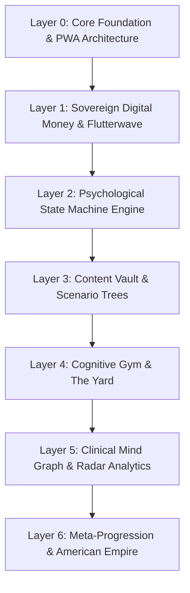

# THE MENTALIST — MASTER DEVELOPMENT BLUEPRINT & EXECUTION PLAN
**Classification:** HIGH-STAKES PSYCHOLOGICAL SIMULATOR & COGNITIVE GYM  
**Architecture:** Zero-Third-Party Local Engine + Flutterwave Sovereign Digital Money Economy + Installable Progressive Web App (PWA)  
**Target Audience:** Ambitious American minds, leaders, innovators, builders, investors.  
**Core Thesis:** "You don't spend. You allocate capital to build your cognitive infrastructure."

---

## 1. System Overview & Core Directives

Based on your design mandate, **The Mentalist** is built with strict adherence to three non-negotiable principles:
1. **Zero External Third-Party Dependencies (Except Payment):**
   - The entire psychological simulation, state machine, branching interrogation trees, dynamic hesitation metrics, CBT mini-games, and clinical Mind Graph run locally on high-performance native browser primitives (Web Audio API, Canvas 2D, LocalStorage/IndexedDB).
   - The **only** third-party network connection is the **Flutterwave Payment Gateway** for purchasing sovereign digital currency and backing commitment contracts.
2. **Sovereign Digital Money System (Fund Balance / Digital Coins):**
   - No direct pay-to-play activation.
   - Users fund their **Cognitive Capital Balance** in exchange for **Cognitive Credits (₡)**.
   - Credits are strategically allocated to unlock advanced interrogations, acquire Charlie Munger / Stoic mental model packs, upgrade Empire cognitive infrastructure, and stake **"Skin in the Game" Discipline Bonds**.
3. **PWA Installability ("Install from Web as an App"):**
   - Standalone application manifest (`manifest.json`), service worker (`sw.js`) with offline caching, high-resolution icons, and a native app install prompt banner.
   - Feels identical to an installed native desktop/mobile terminal (no browser address bar, instant launch).
4. **Layered & Staged Construction:**
   - Every architectural component is divided into sequential layers and tracked in `DEVELOPMENT_STATE.json` so no logic, questions, or progress are lost.

---

## 2. Flutterwave API Configuration Space

We have prepared two primary methods for you to input your Flutterwave API credentials:

### Method A: Configuration File ([flutterwave.config.js](file:///c:/Users/USER/mentalist/config/flutterwave.config.js))
You can paste your keys directly into [config/flutterwave.config.js](file:///c:/Users/USER/mentalist/config/flutterwave.config.js):
```javascript
export const FLUTTERWAVE_CONFIG = {
  PUBLIC_KEY: "FLWPUBK_TEST-YOUR-PUBLIC-KEY-HERE", // Paste Flutterwave Public Key
  SECRET_KEY: "FLWSECK_TEST-YOUR-SECRET-KEY-HERE", // Paste Flutterwave Secret Key
  ENCRYPTION_KEY: "FLWSECK_TEST_ENC-YOUR-KEY",     // Paste Encryption Key
  ENVIRONMENT: "sandbox",                          // 'sandbox' or 'live'
  CURRENCY: "USD",                                 // USD, NGN, GBP, EUR
  // ...
};
```

### Method B: In-App "Executive Key Terminal"
Inside the running application under **Settings / Terminal Config**, you will have a live secure input modal where you can paste your Flutterwave Public & Secret Keys. The application instantly stores them into encrypted local storage and toggles between Sandbox and Live mode without needing to restart the app or edit code.

---

## 3. The 7 Architectural Layers & Implementation Stages



### Layer 0: Core Foundation & Progressive Web App (PWA) Architecture
- **Stage 0.1: PWA Web App Manifest & Service Worker**
  - `manifest.json`: Standalone display mode, high-contrast dark theme (`#070a0e`), custom splash screens, app badges.
  - `sw.js`: Robust Cache-First Service Worker for asset caching, offline resilience, and dynamic install prompt trigger.
- **Stage 0.2: Surgical High-Contrast Terminal UI (Bloomberg meets Psychological Thriller)**
  - Palette: Deep carbon (`#070a0e`), obsidian slate (`#111722`), surgical cyan (`#00e5ff`), gold/platinum bullion accents (`#d4af37`), danger crimson (`#ff3366`).
  - Typography: Sharp monospace data fonts (*JetBrains Mono / Space Mono*) paired with crisp editorial serif/sans (*Cinzel / Inter*).
  - Micro-interactions: CRT scanlines, subtle telemetry grids, audio visualizer bars, and tension gauges.
- **Stage 0.3: Web Audio SFX Engine (Zero External Audio Dependencies)**
  - Synthesized via Web Audio API:
    - 60-80-120 BPM adaptive heartbeat monitor that speeds up as Cognitive Load rises.
    - Analog ticking clock during interrogation hesitation countdown.
    - Low-frequency interrogation room ambient drone (40Hz binaural binaural pulse).
    - Biometric alarm spike on critical cognitive traps.
- **Stage 0.4: Master Persistence & State Machine Storage**
  - Automatic snapshotting to `localStorage` and `IndexedDB`.
  - Crash-proof state recovery: If the user reloads or closes the window during an interrogation or payment, state is restored seamlessly without loss.

---

### Layer 1: Sovereign Digital Money System & Flutterwave Integration
- **Stage 1.1: Cognitive Credit (₡ CC) Ledger & Digital Wallet**
  - Immutable local ledger recording every capital allocation, expenditure, and bond yield.
  - Non-direct pay-to-use: Users fund their credit balance first.
  - Credit denominations:
    - **Seed Capital:** $4.99 → 500 CC
    - **Growth Capital:** $9.99 → 1,200 CC (+20% bonus)
    - **Institutional Capital:** $24.99 → 3,500 CC (+40% bonus)
    - **Sovereign Mind Allocation:** $49.99 → 8,000 CC (+60% bonus)
- **Stage 1.2: Flutterwave Inline V3 Payment Gateway**
  - Loads Flutterwave V3 Inline script dynamically.
  - Passes user email, selected capital tier, currency, and transaction reference (`MENTALIST_TX_...`).
  - On successful callback: verifies status, updates player's Cognitive Credit ledger, displays high-status receipt: *"Capital Allocated Successfully. Your cognitive infrastructure has been upgraded. The Mentalist will notice."*
  - Provides a built-in "Sandbox Simulator" toggle so you can test payment completion immediately even before inputting live keys.
- **Stage 1.3: "Skin in the Game" Discipline Bonds (Escrow System)**
  - Behavioral economics commitment contract:
    - Player locks $10 (1,000 CC) or $25 (2,500 CC) for a 30-day challenge.
    - Must complete daily dossiers and pass interrogations.
    - On success: 125% - 150% return on capital + exclusive "Iron Mind" status.
    - On failure: capital forfeited to financial literacy charity.
- **Stage 1.4: In-Game Executive Security & API Key Manager**
  - Settings screen modal for instant key updates and sandbox/live status checks.

---

### Layer 2: Psychological State Machine Engine
- **Stage 2.1: Hidden Metric Equations**
  - Tracks 4 real-time psychological variables (0-100%):
    1. **Cognitive Load ($CL$):** Increases on emotional responses and hesitation ($CL_{t+1} = CL_t + \Delta_{choice} + \Delta_{hesitation}$). If $CL \ge 100\%$, player suffers a panic failure and is remanded to The Yard.
    2. **Ego / Defensiveness ($ED$):** Spikes when player justifies bad decisions or argues. Triggers Authority Traps.
    3. **Scarcity / Fear Index ($SF$):** Increases on loss-averse, short-term survival decisions.
    4. **Stoic / Wealth Alignment ($SW$):** Increases on objective, probabilistic, long-term decisions.
- **Stage 2.2: 4-Mode Mentalist Persona Engine**
  - **Mode 1: The Observer (Baseline)** — Calm, analytical, dissects strategy.
  - **Mode 2: The Provocateur (Pressing)** — Sarcastic, rapid-fire attacks on fear and scarcity.
  - **Mode 3: The Interrogator (Hostile NLP)** — Aggressive, questions their right to be an American builder.
  - **Mode 4: The Trap-Setter (Deceptive Conny Strategy)** — Softens tone, feigns empathy, offers seductive off-the-books shortcuts.
- **Stage 2.3: 5-Phase Surgical Progression**
  1. *Phase 1: The Intake (0-15%)* — Establish dominance, present crisis, spike initial load.
  2. *Phase 2: The Baseline Probe (15-40%)* — Probe default cognitive biases.
  3. *Phase 3: The Crucible / The Trap (40-75%)* — Core dilemma (Wealth Mindset vs Scarcity Mindset).
  4. *Phase 4: The Squeeze (75-90%)* — Escalation: hostile assault or deceptive honey-trap.
  5. *Phase 5: The Verdict (90-100%)* — Final psychiatric evaluation: Remanded to The Yard OR Cleared as an American Builder.
- **Stage 2.4: Real-Time Dynamic Escalation**
  - **Hesitation Penalty:** If no response in 8s: *"Take too long to think, and the market makes the choice for you."* (+5% CL). If >15s: *"Silence is just fear wearing a suit."* (+10% ED).
  - **Keyword Trigger System:** Scans dialogue for scarcity words (*"Hope", "Try", "Fair", "Unfair", "Impossible"*).
  - **"Too Perfect" Override:** If player breezes through with 0% cognitive load, injects a Black Swan surprise crisis.

---

### Layer 3: Content Vault & Scenario Trees
- **Stage 3.1: 4 American Builder Archetypes**
  1. *Tech Disruptor / Innovator* (Vulnerabilities: Imposter syndrome, vanity metrics, co-founder loyalty traps).
  2. *Wall Street Quant / Business Leader* (Vulnerabilities: Loss aversion, mathematical hubris, leverage panic).
  3. *Real Estate Mogul* (Vulnerabilities: Debt spirals, illiquidity panic, sunk cost).
  4. *Legacy Builder / Industrialist* (Vulnerabilities: Relevance anxiety, antitrust scrutiny, succession fear).
- **Stage 3.2: 5 Fully Fleshed-Out Master Scenarios**
  - **Scenario 1: The Sunk Cost & Ego Trap** ($5M Flagship vs Free Competitor, B2B pivot, 30% layoffs).
  - **Scenario 2: The Co-Founder Embezzlement Dilemma** (Pre-IPO fraud discovery, board silence vs whistleblowing).
  - **Scenario 3: The 2008 Black Swan Liquidity Squeeze** (Margin calls, counterparty collapse, predatory PE offers).
  - **Scenario 4: The Commercial Debt Refinancing Cliff** (Expiring balloon note, corrupt zoning shortcut vs bankruptcy restructuring).
  - **Scenario 5: The Standard Oil Antitrust Crucible** (Rockefeller-scale monopoly lawsuit, buyout vs martyrdom).
- **Stage 3.3: Dynamic Dialogue Wheel (Beyond A/B/C)**
  - 4 Dynamic Response Nodes per decision point: `[Stoic Deflection]`, `[Defend Ego]`, `[Show Fear/Scarcity]`, `[Counter-Attack/Abundance]`.

---

### Layer 4: Cognitive Gym & "The Yard" (Rehabilitation)
- **Stage 4.1: "The Yard" (Jail) Debriefing & Rehabilitation Modules**
  - Failure is not game over; it is a clinical psychological debrief.
  - Interactive micro-courses to earn clearance:
    - *Module A:* Overcoming Loss Aversion & Sunk Cost.
    - *Module B:* Charlie Munger's Inversion & Mental Models.
    - *Module C:* Marcus Aurelius & Stoic Emotional Regulation.
- **Stage 4.2: "Flip the Script" CBT Distortion Reframing Game**
  - 60-second speed drill identifying and reframing 6 clinical cognitive distortions:
    - Catastrophizing, Emotional Reasoning, Black-and-White Thinking, Fortune Telling, Personalization, Scarcity Bias.
- **Stage 4.3: Probability Calibration Simulator**
  - High-pressure mathematical decision-making under duress.

---

### Layer 5: Clinical Mind Graph & Radar Analytics
- **Stage 5.1: HTML5 Canvas 6-Axis Radar Chart**
  - 6 Clinical Dimensions:
    1. *Locus of Control (Internal Builder vs External Victim)*
    2. *Resilience & Grit Index*
    3. *Financial Emotional Quotient (FEQ)*
    4. *Risk & Volatility Tolerance*
    5. *Stoic Emotional Regulation*
    6. *Ethical & Strategic Integrity*
- **Stage 5.2: Surgical Dossier & Clearance Verdict**
  - Generates comprehensive psychological evaluation, detected blindspots, and recommended cognitive prescriptions.
- **Stage 5.3: Shareable Dossier Card (Viral Growth Loop)**
  - High-status, classified card exportable as an image for social comparison.

---

### Layer 6: Meta-Progression & American Empire Visualizer
- **Stage 6.1: "American Empire" Base Building Grid**
  - Construct and upgrade high-status visual facilities using Mind Capital:
    - *Behavioral Economics Library* (Passive credit yield + analytical boost).
    - *Stoic Resilience Training Center* (Increases hesitation timer).
    - *High-Frequency Quant Terminal* (Enhances probability calculations).
- **Stage 6.2: Psychological Skill Tree**
  - Unlockable cognitive defenses:
    - *The Stoic Pause:* +3 seconds before hesitation penalties kick in.
    - *Loss Aversion Shield:* 20% dampening on Mentalist fear provocations.
    - *Inversion Lens:* Highlights deceptive traps in Mentalist dialogue.
- **Stage 6.3: Daily Dossiers & Streaks**
  - 2-minute daily market behavioral dilemmas rewarding "Mental Momentum" streaks.

---

## 4. Execution Sequence & Time Allocation Plan

To ensure maximum solidity, stability, and zero crashes, the development is sequenced systematically:

| Phase | Focus Area | Deliverables | Verification Milestone |
|---|---|---|---|
| **Phase 1** | Foundation, Storage & PWA | `manifest.json`, `sw.js`, `index.html`, `css/`, `storage.js`, `audio.js` | App loads, audio plays, installs as PWA, state saves/restores |
| **Phase 2** | Sovereign Digital Money & Flutterwave | `economy.js`, `payment.js`, `bonds.js`, in-app key terminal | Balance funding works, Flutterwave modal connects, receipt prints |
| **Phase 3** | Interrogation Engine & State Machine | `interrogation.js`, metrics math, timers, mode switching | Stress levels respond to dialogue, hesitation penalties fire |
| **Phase 4** | The Content Vault (5 Master Scenarios) | `scenarios.js`, dialogue wheel, branching trees, traps | All 5 scenarios fully playable with all 4 Builder archetypes |
| **Phase 5** | Cognitive Gym & The Yard | `yard.js`, `cbt.js`, `probability.js` | Failure sends to Yard, CBT mini-game restores stamina |
| **Phase 6** | Mind Graph & Empire Progression | `radar.js`, `empire.js`, `skills.js`, `dossier.js` | Canvas radar renders beautifully, empire buildings construct |
| **Phase 7** | Surgical Polish & Full Verification | Browser testing, responsiveness, edge-case hardening | Complete end-to-end run from funding balance to trial clearance |
